# themes

Full-interface themes for Claude Code, in the terminal and the desktop app. Fifteen themes; pick one and the whole conversation changes with it: your messages, Claude's replies, every tool call, the spinner and a usage bar above the prompt. Switch any time with `/themes`; your choice is remembered.

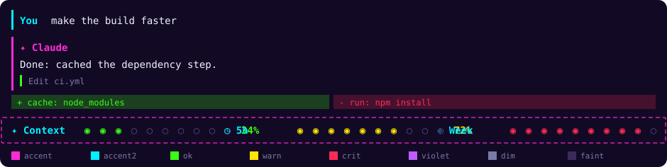

## What a theme changes

Each theme has two parts:

- **The look drawn by the mod**, in the terminal, the desktop app and the VS Code extension:
  - your messages get a labelled accent bar, and Claude's replies a `Claude` header and bar
  - each tool call gets a bar that is yellow while it runs, green when it succeeds and red on error, with results in a quiet shade
  - the spinner leads with the theme's glyph
  - a usage bar above the prompt shows Context, 5h and Week, in the theme's own bar shape and border
- **A terminal colour theme** (`themes/<slug>.json`), which recolours Claude Code's own terminal interface: prompt border, dialogs, diffs, status colours, selection and the subagent colours. Pick it with `/theme` in the terminal.

| Part | Terminal | Desktop app | VS Code |
| --- | --- | --- | --- |
| Messages, tool rows, spinner, usage bar, `/themes` pane | yes | yes | yes |
| Colour theme (`/theme`) | yes | no, `/theme` opens the app's own settings | not tested |

The desktop app draws its window itself, so the colour theme cannot be selected there. The mod's own look still applies in full.

## Themes

Fifteen themes, each with its own palette, border, bar shape and spinner glyph.

<!-- themes:start -->
| Theme | Look | Bar |
| --- | --- | --- |
| [`classic`](#classic) | Claude orange on charcoal with green, amber and rose status colours. | coloured blocks |
| [`cyberpunk`](#cyberpunk) | Yellow and cyan on near-black, hot red alarms. | `▰▱` slabs |
| [`neon`](#neon) | Magenta and cyan on deep purple, acid green for success, hot red for errors. | `◉○` dots |
| [`ocean`](#ocean) | Teal and sky blue on deep navy, amber for the warnings. | `▬·` waterline |
| [`sunset`](#sunset) | Orange to pink to red on a dark plum background. | `◆◇` diamonds |
| [`forest`](#forest) | Greens and mint on dark moss, yellow and coral for the warnings. | `■□` squares |
| [`dracula`](#dracula) | The Dracula palette: purple accent, cyan, green, pink. | `▮▯` pills |
| [`nord`](#nord) | The Nord palette: frost blues with sage, sand and rust. | `■□` squares |
| [`gruvbox`](#gruvbox) | Retro warm: amber, olive, orange on a dark brown. | fine `■▪` bar |
| [`synthwave`](#synthwave) | Hot pink and cyan on dusk purple, mint to yellow to red. | `▶▷` arrows |
| [`candy`](#candy) | Soft pink and sky blue on plum, honey and rose for the warnings. | `♥♡` hearts |
| [`matrix`](#matrix) | Green phosphor on black, lime and red warnings. | binary `1` and `0` |
| [`solarized`](#solarized) | The Solarized dark palette: blue, teal, olive, gold, red. | `▲△` peaks |
| [`mono`](#mono) | One colour for everything, no warning tint. Read the numbers, not the colours. | `█░` shade |
| [`minimal`](#minimal) | Greys with a green, amber and rose bar. | one solid thin bar |

### classic

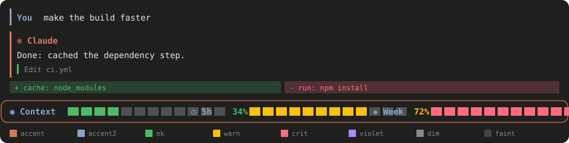

Claude orange on charcoal with green, amber and rose status colours. A round border, coloured blocks, a `✻` spinner.

### cyberpunk

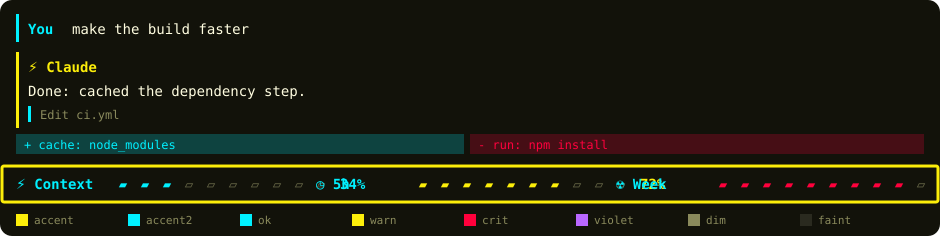

Yellow and cyan on near-black, hot red alarms. A bold border, `▰▱` slabs, a `⚡` spinner.

### neon


Magenta and cyan on deep purple, acid green for success, hot red for errors. A dashed border, `◉○` dots, a `✦` spinner.

### ocean

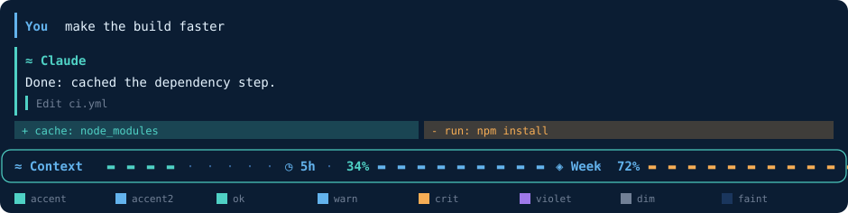

Teal and sky blue on deep navy, amber for the warnings. A round border, `▬·` waterline, a `≈` spinner.

### sunset

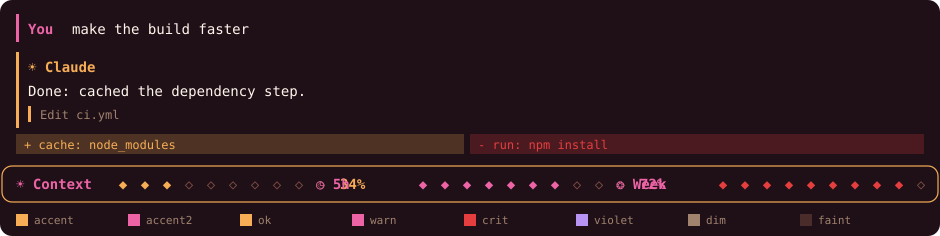

Orange to pink to red on a dark plum background. A round border, `◆◇` diamonds, a `☀` spinner.

### forest

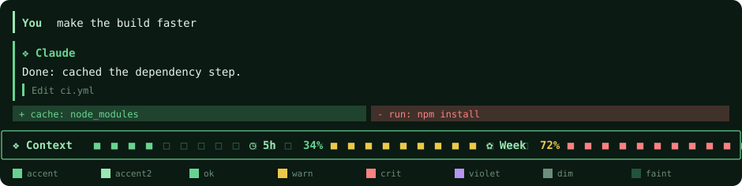

Greens and mint on dark moss, yellow and coral for the warnings. A single border, `■□` squares, a `❖` spinner.

### dracula

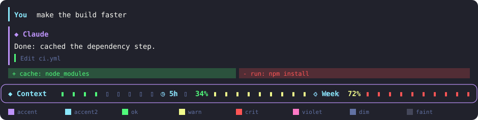

The Dracula palette: purple accent, cyan, green, pink. A round border, `▮▯` pills, a `◆` spinner.

### nord

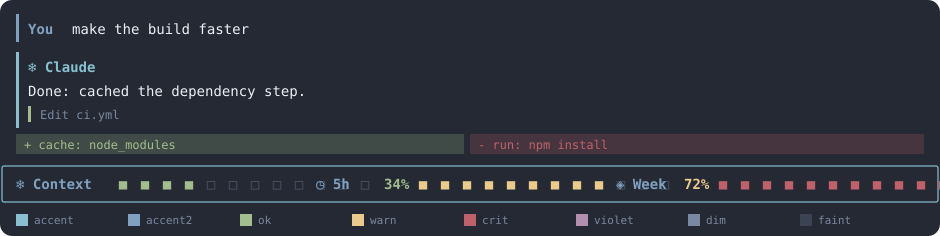

The Nord palette: frost blues with sage, sand and rust. A double border, `■□` squares, a `❄` spinner.

### gruvbox

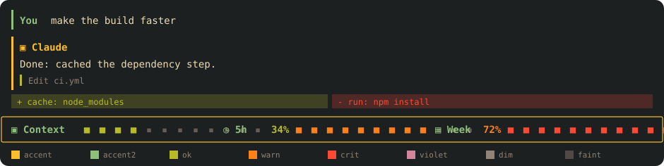

Retro warm: amber, olive, orange on a dark brown. A single border, fine `■▪` bar, a `▣` spinner.

### synthwave

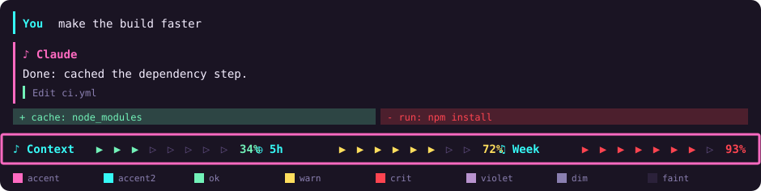

Hot pink and cyan on dusk purple, mint to yellow to red. A bold border, `▶▷` arrows, a `♪` spinner.

### candy

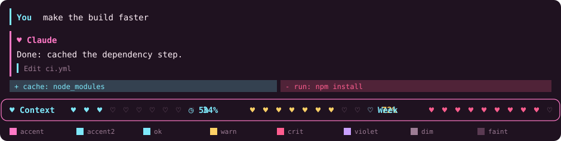

Soft pink and sky blue on plum, honey and rose for the warnings. A round border, `♥♡` hearts, a `♥` spinner.

### matrix

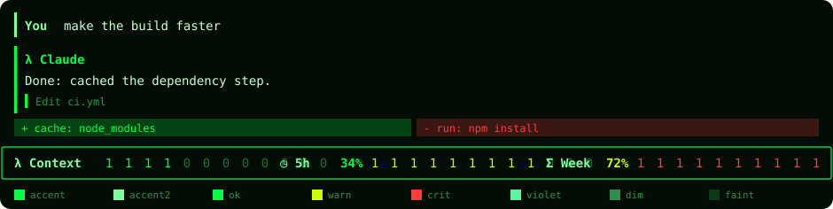

Green phosphor on black, lime and red warnings. A single border, binary `1` and `0`, a `λ` spinner.

### solarized

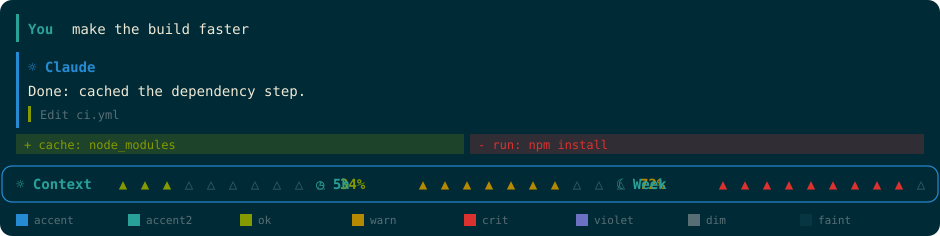

The Solarized dark palette: blue, teal, olive, gold, red. A round border, `▲△` peaks, a `☼` spinner.

### mono

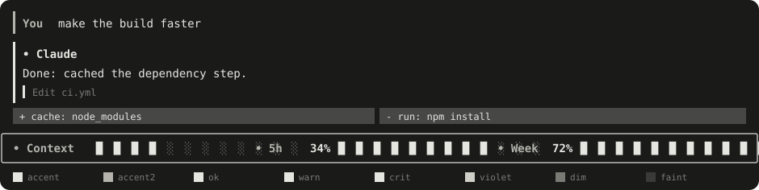

One colour for everything, no warning tint. Read the numbers, not the colours. A single border, `█░` shade, a `•` spinner.

### minimal

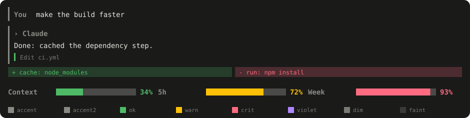

Greys with a green, amber and rose bar. No border, one solid thin bar, a `›` spinner.

<!-- themes:end -->

The images are drawings of each theme, not screenshots, so spacing and glyph size depend on your font.

## Install

In a terminal session:

```
/plugin install themes --marketplace itsmemac/Claude-Mods
```

From a shell:

```bash
claude plugin install themes --marketplace itsmemac/Claude-Mods
```

If your Claude Code is older and rejects `--marketplace`, add the marketplace first and install by name:

```bash
claude plugin marketplace add itsmemac/Claude-Mods
claude plugin install themes@claude-mods
```

Choose the **user** scope, then start a new session. Claude Code may say "1 userConfig option not yet set" after installing. That is the starting theme, and it is optional: it defaults to `neon`.

## Use it

- **Switch theme:** type `/themes` and pick one in the pane, or type `/themes dracula` to switch straight to a theme. The whole interface redraws at once and the choice is remembered across sessions.
- **Terminal colour theme:** run `/theme` and pick the matching entry, for example **Neon**. It is listed as coming from the `themes` plugin. Plugin themes are read-only; if you edit one, the edit is saved as your own copy in `~/.claude/themes/`.
- **Starting theme at install:** `claude plugin install themes@claude-mods --config theme=nord`.

## Notes

- The mod's look needs a recent Claude Code build with mod support. The colour theme file applies in the terminal only.
- The permission prompt and the desktop app's own window, sidebar and composer are not drawn by mods, so they keep their normal look.
- The 5h and Week bars show a dash when your account reports no rate limits.
- Use one usage bar at a time. If you also have the separate [usage-bar](../usage-bar/README.md) mod loaded, its bar is drawn instead of this one; load only one of them.
- A mod change only appears after the app restarts: quit and reopen it, then start a new chat. While developing, a change to `hooks/palettes.js` is picked up once `hooks/register.tsx` reloads too.

## Add a theme

1. Add an entry to `THEMES` in [hooks/palettes.js](hooks/palettes.js): a palette, a border, a bar (a glyph pair, coloured blocks, or one solid bar), icons and a spinner glyph.
2. Add its name to the `theme` description in [.claude-plugin/plugin.json](.claude-plugin/plugin.json).
3. Run `node scripts/build-themes.mjs` from this folder. It writes `themes/<slug>.json` and `docs/img/<slug>.svg`, and regenerates the theme table and sections in this README.

## License

MIT, see [LICENSE](../LICENSE).
