# usage-bar

A responsive status bar above the prompt that shows your context window and your usage limits at a glance, refreshed every 3 seconds. It comes in 15 themes, each with its own colours, border and bar shape.


- **Context**: how full the context window is, with tokens used out of the window.
- **5h**: usage against the 5-hour limit, with time until it resets.
- **Week**: usage against the weekly limit, with time until it resets.

The fill turns to its warning colour at 70% and its critical colour at 90%. The three bars stretch to fill the width of the window and are always the same length.

## Install

In a terminal session:

```
/plugin install usage-bar --marketplace itsmemac/Claude-Mods
```

From a shell:

```bash
claude plugin install usage-bar --marketplace itsmemac/Claude-Mods
```

If your Claude Code is older and rejects `--marketplace`, add the marketplace first and then install by name:

```bash
claude plugin marketplace add itsmemac/Claude-Mods
claude plugin install usage-bar@claude-mods
```

In the desktop app, where `/plugin` does not run: click **+** next to the prompt box, then **Plugins**, **Add marketplace** with `itsmemac/Claude-Mods`, then **Add plugin**.

Choose the **user** scope to have the bar in every session. Start a new chat after installing; a chat that is already open keeps the old UI until it restarts.

After installing, Claude Code may say "1 userConfig option not yet set". That is the theme, and it is optional: the bar uses `classic` until you pick one (see [Choose a theme](#choose-a-theme)). To pick one at install time:

```bash
claude plugin install usage-bar@claude-mods --config theme=neon
```

**Requires** a recent Claude Code build with mod support. An older `claude plugin validate` may not recognise the `userConfig` field.

## Choose a theme

Set the theme in the config menu (the plugin's **Theme** row, where you type the name), or in `settings.json`, replacing `<theme>` with a name from the table below:

```json
{ "pluginConfigs": { "usage-bar": { "options": { "theme": "<theme>" } } } }
```

The default is `classic`, and an unknown name falls back to it. A change reloads the mod with the new look.

| Theme | Border | Bar shape | Colours |
| --- | --- | --- | --- |
| [`classic`](#classic) | rounded | coloured blocks | Your Claude theme |
| [`cyberpunk`](#cyberpunk) | bold | `▰▱` slabs | Yellow, cyan, hot red |
| [`neon`](#neon) | dashed | `◉○` dots | Magenta, acid green |
| [`ocean`](#ocean) | rounded | `▬·` waterline | Blue, teal, amber |
| [`sunset`](#sunset) | rounded | `◆◇` diamonds | Orange, pink, red |
| [`forest`](#forest) | single | `■□` squares | Green, mint, coral |
| [`dracula`](#dracula) | rounded | `▮▯` pills | Purple, green, red |
| [`nord`](#nord) | double | five step blocks | Steel blue, sage, rust |
| [`gruvbox`](#gruvbox) | single | `■▪` squares | Amber, olive, orange |
| [`synthwave`](#synthwave) | bold | `▶▷` arrows | Pink, cyan, mint |
| [`candy`](#candy) | rounded | `♥♡` hearts | Pink, sky blue, rose |
| [`matrix`](#matrix) | single | `1` and `0` digits | Phosphor green |
| [`solarized`](#solarized) | rounded | `▲△` peaks | Blue, teal, olive, gold |
| [`mono`](#mono) | single | `█░` shade | One colour |
| [`minimal`](#minimal) | none | one solid thin bar | Plain |

## The themes

The images show Context at 34%, 5h at 72% and Week at 93%. They are drawings of the bar, not screenshots, so spacing and glyph size depend on your font.

### classic


Default. Rounded border and orange labels with 12 coloured blocks, using your Claude theme colours so it matches whatever theme you already use.

Use it: `"theme": "classic"`

### cyberpunk

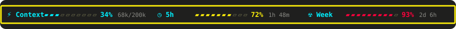

Bold yellow border, cyan labels, yellow warning and hot-red critical.

Use it: `"theme": "cyberpunk"`

### neon

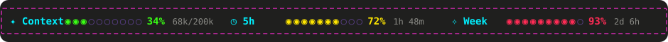

Dashed magenta border, cyan labels, acid green to yellow to red. Best on dark backgrounds.

Use it: `"theme": "neon"`

### ocean

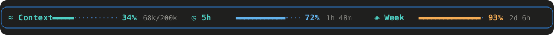

Blue rounded border, teal labels, bars from teal to light blue to amber. A waterline of solid `▬` strokes over small dots.

Use it: `"theme": "ocean"`

### sunset

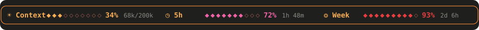

Orange rounded border; colours shift from orange to pink to red as usage grows.

Use it: `"theme": "sunset"`

### forest

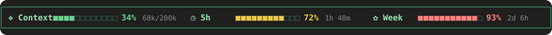

Green single border, mint labels, bars from green to yellow to coral.

Use it: `"theme": "forest"`

### dracula

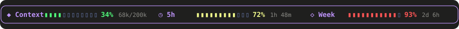

Purple rounded border and labels on the Dracula palette: green, yellow, red.

Use it: `"theme": "dracula"`

### nord

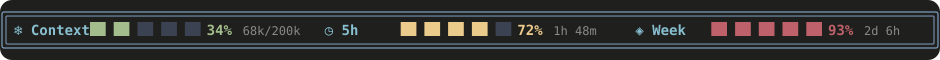

Double steel-blue border and frost labels on the Nord palette: sage, sand, rust. A five-block step meter.

Use it: `"theme": "nord"`

### gruvbox

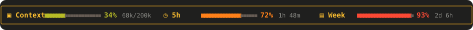

Retro warm palette: single amber border, yellow labels, olive to orange to red. Big `■` squares for the filled part, small `▪` for the rest.

Use it: `"theme": "gruvbox"`

### synthwave

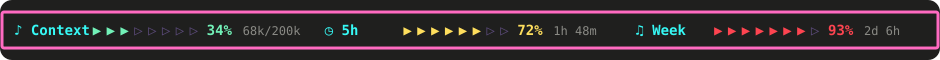

Bold pink border, cyan labels, mint to yellow to red.

Use it: `"theme": "synthwave"`

### candy

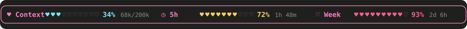

Soft pink rounded border with pink labels, sky blue to honey to rose.

Use it: `"theme": "candy"`

### matrix

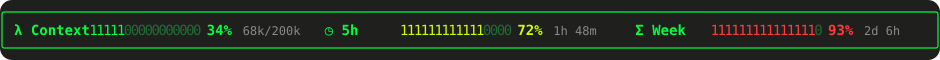

Green phosphor on a single green border, lime and red warnings, `λ` and `Σ` icons. Bar of binary digits: `1` for filled, `0` for empty.

Use it: `"theme": "matrix"`

### solarized

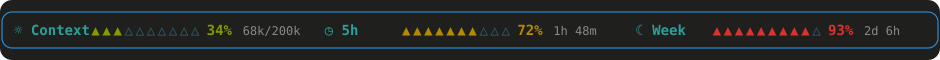

Solarized palette: blue rounded border, teal labels, olive to gold to red.

Use it: `"theme": "solarized"`

### mono

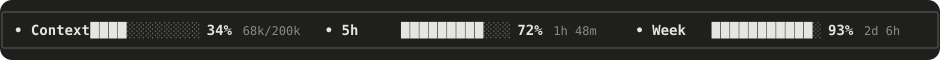

One colour for everything, no warning tint. Works on any terminal palette; read the percentage to judge usage.

Use it: `"theme": "mono"`

### minimal

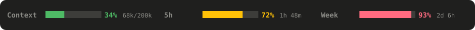

No border or icons, one solid thin bar. Takes the least space and attention.

Use it: `"theme": "minimal"`

## Responsive layout

The bar fills the width of the window and redraws when you resize. If the window is too narrow for three meters side by side, they wrap onto extra rows instead of overlapping.

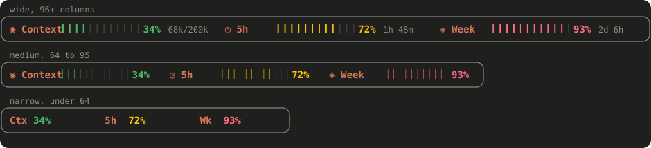

| Width | Layout |
| --- | --- |
| 96+ columns | Full: bars, token counts and reset timers |
| 64–95 | Bars only, no notes |
| under 64 | Percentages only, short labels |
| under 40 | The border is dropped as well |

## Notes

- The 5h and Week bars show an empty bar and a dash when your account reports no rate limits, for example off a subscription or on a custom API address. The Context bar always works.
- The Context figure changes when the model finishes a response, not word by word while it streams. Limits and reset timers refresh every 3 seconds.
- A mod change only appears after the app restarts: quit and reopen it, then start a new chat.

## Development

Changing or adding a theme touches four places:

1. `THEMES` in [hooks/register.tsx](hooks/register.tsx): the colours, border, icons, block count and optional glyph pair.
2. The `theme` options list in [.claude-plugin/plugin.json](.claude-plugin/plugin.json).
3. The table in [docs/generate-previews.mjs](docs/generate-previews.mjs), then run `node docs/generate-previews.mjs` to redraw the images in `docs/img`.
4. A section in this README and the theme count in the root README.

Check the module with `claude plugin validate usage-bar`. Version 0.1.0.

## License

MIT, see [LICENSE](../LICENSE).
